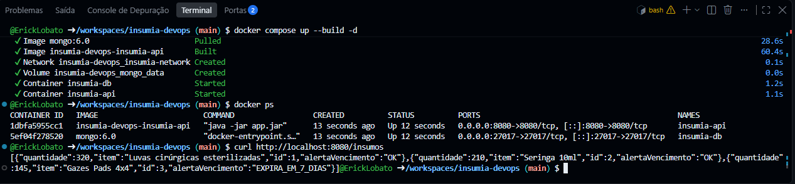
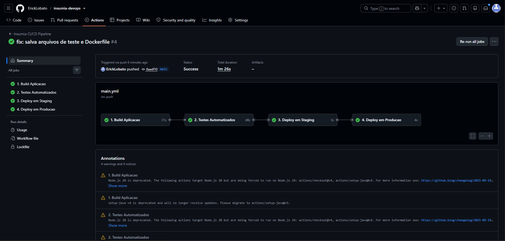
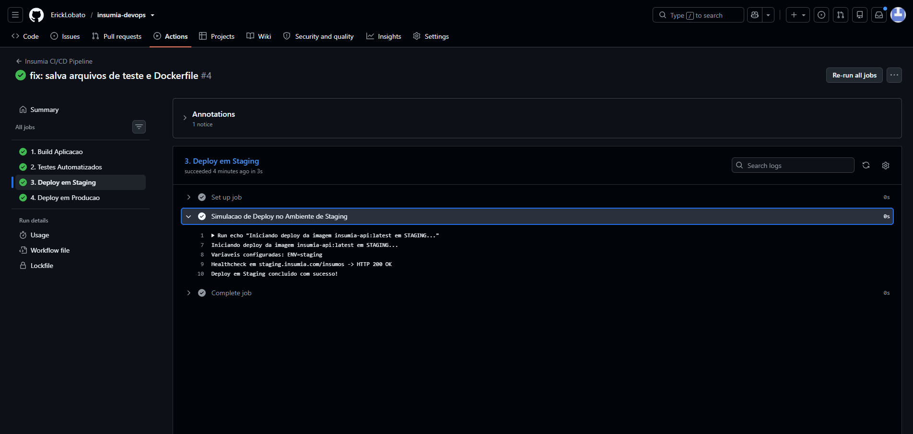

# Projeto - Insumia (Gestão Inteligente de Insumos Hospitalares - ESG)

Aplicação voltada à governança e sustentabilidade hospitalar (ESG), reduzindo o desperdício de insumos médicos por vencimento através de monitoramento inteligente de estoque.

## Como executar localmente com Docker

1. Clone o repositório:
   ```bash
   git clone [https://github.com/ErickLobato/insumia-devops.git](https://github.com/ErickLobato/insumia-devops.git)
   cd insumia-devops
## Prints do funcionamento

### 1. Execução Local (Docker Compose + API)


### 2. Pipeline CI/CD (GitHub Actions)


### 3. Deploy em Staging e Produção
   
